[简体中文](README_cn.md) · <b>English</b>

<a href="https://captainjd.top/">
  <picture>
    <source media="(prefers-color-scheme: dark)" srcset="assets/banner-dark.svg">
    
  </picture>
</a>

  
  
  

 

I'm a Computer Science graduate, a Master's student in Artificial Intelligence, and an independent developer.
I care about useful, easy-to-use products with attention to detail — software that is **calm, personal, and built for real-world needs**.

🌐 **My personal website → [captainjd.top](https://captainjd.top/)** — travel map, logbook, reading list, music, games, and everything I'm working on.

 

## 01 — Currently Building

<table>
  <tr>
    <td width="132" align="center" valign="top">
      
    </td>
    <td valign="top">
      <b>ANDROID</b> · PHONES · TABLETS · FOLDABLES 
      <a href="https://infinite-project.top/reader/"><b>Infinite Reader</b></a> — <i>Reading without boundaries.</i>
      
A focused reading app for people who want their digital library to feel simple, personal, and distraction-free. Read EPUB, TXT, and PDF; organize books your way, keep notes and reading progress, and optionally sync across devices — while staying fully usable offline.

      <code>Android</code> <code>Kotlin</code> <code>Readium</code> &nbsp; <a href="https://infinite-project.top/reader/">infinite-project.top/reader →</a>
    </td>
  </tr>
  <tr>
    <td width="132" align="center" valign="top">
      
    </td>
    <td valign="top">
      <b>DESKTOP</b> · WINDOWS · MACOS · LINUX 
      <a href="https://infinite-project.top/studio/"><b>Infinite Studio</b></a> — <i>A calm IDE with AI by your side.</i>
      
A minimal desktop IDE in shades of grey with one accent colour you choose. Work with Claude Code, Codex, Kimi Code, or DeepSeek Harness in a built-in chat panel; write, run, and debug Python, Java, and C/C++; manage Git with a visual commit graph; preview PDF, Word, Excel, and PowerPoint without leaving the editor. Everything runs locally, with no telemetry.

      <code>Desktop</code> <code>TypeScript</code> <code>Electron</code> &nbsp; <a href="https://infinite-project.top/studio/">infinite-project.top/studio →</a>
    </td>
  </tr>
  <tr>
    <td width="132" align="center" valign="top">
      
    </td>
    <td valign="top">
      <b>BETA</b> · WEB · WELLNESS 
      <a href="https://helix-web.junji-duan.workers.dev/"><b>Helix</b></a> — <i>Small lights for difficult moments.</i>
      
An evidence-based app for difficult moments. It is a mood journal that remembers the small lights in your life, and a source of gentle, scientifically grounded exercises and support when darker moments arrive.

      <code>Web</code> <code>Wellness</code> <code>Beta</code> &nbsp; <a href="https://helix-web.junji-duan.workers.dev/">Try Helix →</a>
    </td>
  </tr>
</table>

 

## 02 — Education

<table>
  <tr>
    <td width="132" align="center" valign="top">
      
    </td>
    <td valign="top">
      <b>2025 — NOW</b> · SYDNEY, NSW, AUSTRALIA 
      <a href="https://www.unsw.edu.au/"><b>The University of New South Wales</b></a> 
      Master of Information Technology — <b>Artificial Intelligence</b>
    </td>
  </tr>
  <tr>
    <td width="132" align="center" valign="top">
      
    </td>
    <td valign="top">
      <b>2020 — 2025</b> · MONTRÉAL, QUÉBEC, CANADA 
      <a href="https://www.mcgill.ca/"><b>McGill University</b></a> 
      Bachelor of Science — <b>Computer Science</b>
    </td>
  </tr>
</table>

 

## 03 — Research &amp; Practice

  
  
  
  
  

> [!NOTE]
> **Research on Image Recognition and Processing Application Technology of Unmanned Vehicle Based on Deep Learning**
>  *Applied and Computational Engineering* · Vol. 93, pp. 191–197 · 2024
>  [`doi:10.54254/2755-2721/93/20240986`](https://doi.org/10.54254/2755-2721/93/20240986)

 

## 04 — Toolbox

  <picture>
    <source media="(prefers-color-scheme: dark)" srcset="https://skillicons.dev/icons?i=ts%2Cpy%2Cjs%2Ckotlin%2Cswift%2Cnextjs%2Csvelte%2Celectron%2Ctailwind%2Cpostgres%2Csupabase%2Cdocker%2Cgit&theme=dark&perline=13">
    
  </picture>

 

---

<b>LIVE LONG AND PROSPER.</b> 
Explore more channels — wander, logbook, reading, music, games — at <a href="https://captainjd.top/">captainjd.top</a> ∞

